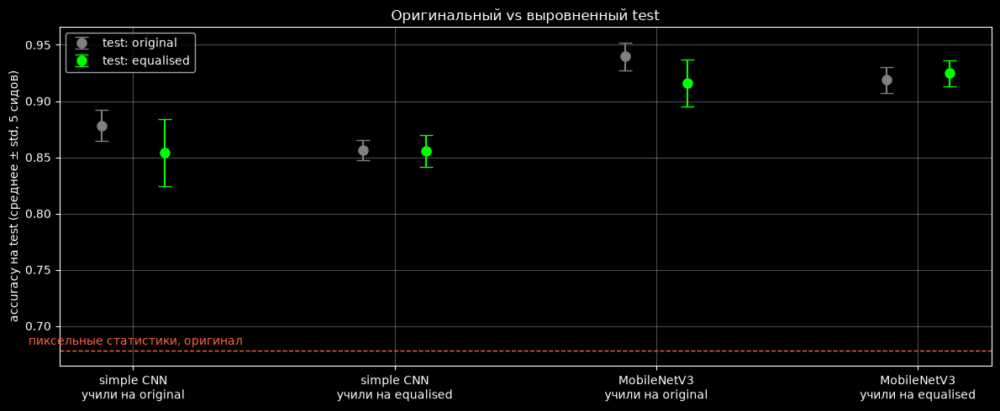
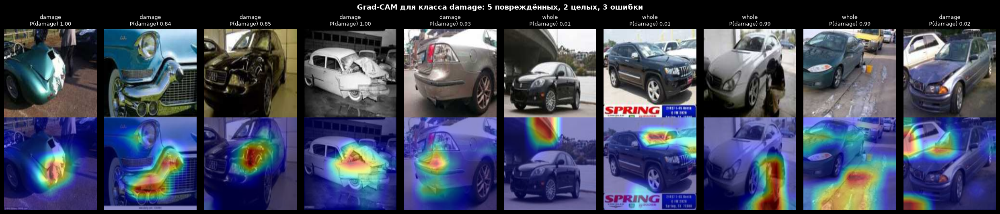
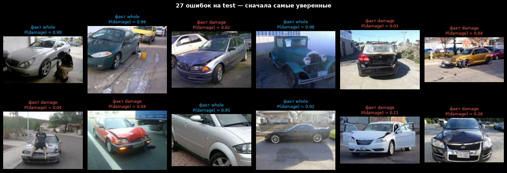

# Car damage classification — does the CNN see the damage?

Binary classifier for car photos: **damaged** or **whole**. PyTorch on Apple Silicon (MPS):
a small CNN trained from scratch against a fine-tuned MobileNetV3, plus a check for a shortcut
hidden in the data. Notebooks are in Russian.

| Notebook | What it is |
|---|---|
| `car_damage_PyTorch.ipynb` | v1 — small CNN, 90.65 % (the test set was also used to monitor training) |
| `car_damage_PyTorch_v2.ipynb` | v2 — data audit, honest split, 2 models × 2 data versions × 5 seeds, McNemar, Grad-CAM |

## The catch in the data

The two classes come from different sources: damage photos are small web thumbnails
(median 260 × 194 px, 9 KB), whole-car photos are camera shots twice as wide and five times
heavier. Without looking at a single car:

| Baseline, no CNN | Test accuracy |
|---|---|
| Majority class | 50 % |
| Random forest on width, height, file size, aspect ratio | 83 % |
| Logistic regression on 3 pixel statistics (sharpness, gradient energy, JPEG blockiness) | 68 % |

A network can score well by telling a *soft upscaled thumbnail* from a *sharp photo*. To measure
and remove that, every photo can be **equalised** — shrunk to 192 px and re-encoded at JPEG
quality 50 — which keeps the content and drops the source fingerprint.

## Results

Test: 460 photos, balanced. Training set cleaned of 18 images (8 near-duplicates of test photos);
15 % of it held out for validation — early stopping and model choice never see the test set.
Five seeds per setup; the small CNN keeps the v1 architecture and hyper-parameters.

| Model | Trained on | Test: original | Test: equalised |
|---|---|---|---|
| Small CNN (432k params, from scratch) | original | 87.8 % ± 1.4 | 85.4 % ± 3.0 |
| Small CNN | equalised | 85.7 % ± 0.9 | **85.6 % ± 1.4** |
| MobileNetV3-Large (ImageNet, fine-tuned) | original | 94.0 % ± 1.3 | 91.6 % ± 2.1 |
| MobileNetV3-Large | equalised | 91.9 % ± 1.2 | **92.5 % ± 1.2** |

- **Models trained on original photos lean on the fingerprint:** remove it from the test photos
  and they lose 2.4 points on average. Trained on equalised photos, they do not care.
- **Honest numbers (bold):** MobileNetV3 92.5 %, small CNN 85.6 %. MobileNetV3 is better for
  every seed (McNemar on the same test photos, p ≤ 0.002): pretraining is worth 7 points on
  1,500 photos. The 90.65 % of v1 was ~86 % of real skill plus the shortcut.
- **Final model** (seed chosen on validation): 94.1 % on test, 95 % interval 91.6–95.9 %;
  damage recall 92.6 % at 95.5 % precision.



## Where the model looks, and where it fails

Grad-CAM for the "damage" class: on recognised damage the heat sits on the deformation itself.
Two kinds of errors — damaged cars photographed whole from a distance (the damage is a small part
of the frame), and intact cars in a messy scene (puddles and buckets, a person crouching by the
wheel), where the heat lands on the surroundings rather than the car.





## Run

The dataset (`data1a/training`, `data1a/validation`) comes from the Veravlaedu Data Science
programme; put it next to the notebooks.

```bash
pip install torch torchvision scikit-learn statsmodels pandas matplotlib jupyterlab
jupyter lab car_damage_PyTorch_v2.ipynb
```

Runs on Apple MPS or CPU; the 20 training runs take about 18 minutes on an M-series Mac. The
notebook saves the final model to `models/`; the Gradio demo in `demo/` loads it:

```bash
cp models/car_damage_mobilenetv3_2026-10-25.pt demo/
pip install -r demo/requirements.txt gradio
python demo/app.py
```
